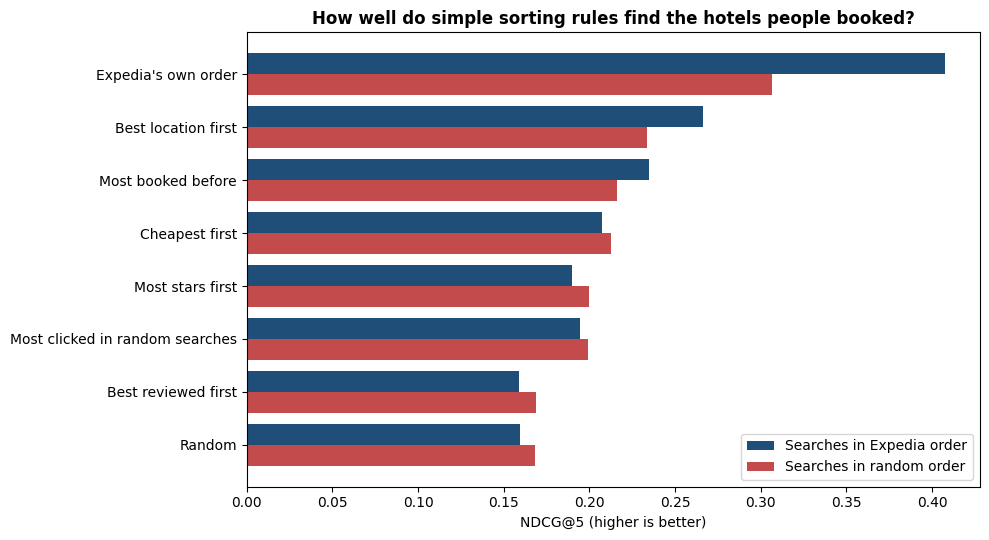
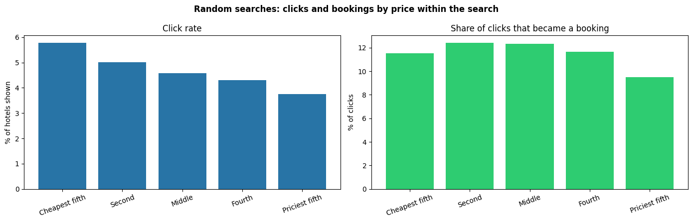
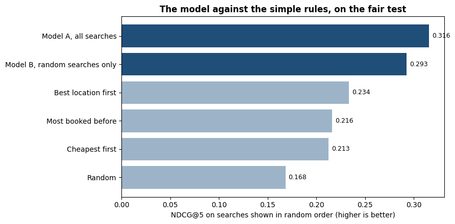
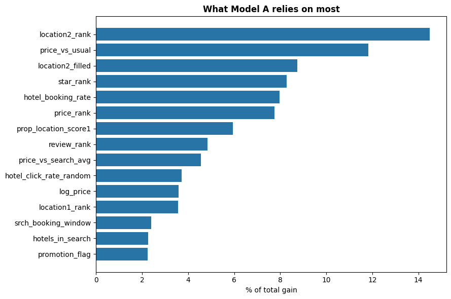
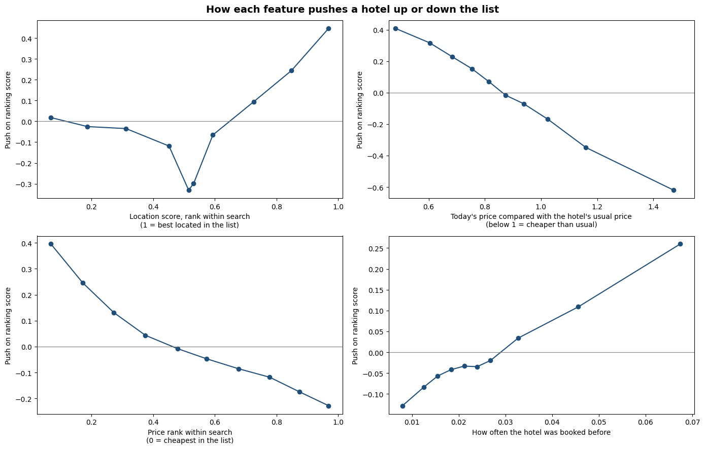
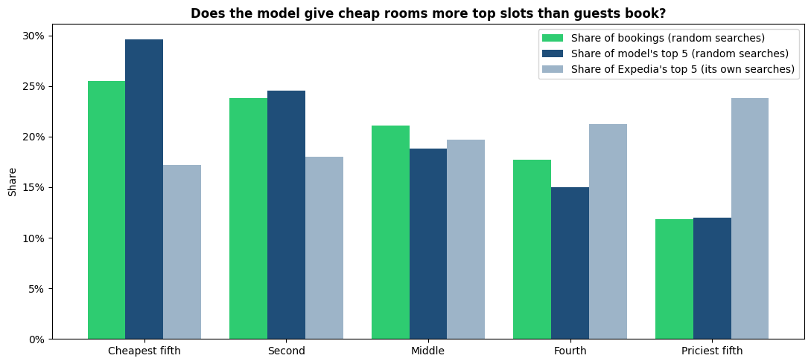
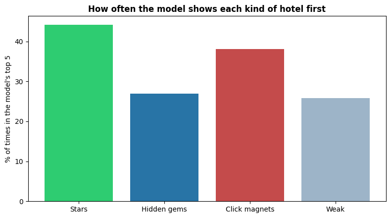

# Hotel Search Ranking

When someone searches for a hotel, which hotels should go at the top so that they actually book?

This project uses real hotel searches from Expedia to build a ranking model, and then looks at the results the way a hotelier would. I spent over a decade in hospitality before moving into data, so the question I care about isn't only "does the model score well?". It's also "is it pushing cheap rooms that people click on but don't book?"

**Status:** complete.

## In short

* **The model beats every simple sorting rule by 35%** on a fair test, and gets within about 8% of Expedia's own ranking without using page position.
* **Position on the page triples clicks on its own**, so I measured it with Expedia's randomly ordered searches and kept it out of the model.
* **Guests respond to a deal more than to a low price.** Today's price compared with the hotel's usual price is the strongest driver in the model.
* **The weak spot:** the model still favours hotels that attract clicks over hotels that turn clicks into bookings. I explain how I'd fix it.

## The data

[Personalize Expedia Hotel Searches (ICDM 2013)](https://www.kaggle.com/c/expedia-personalized-sort), from Kaggle. About 10 million rows from roughly 400,000 searches. For each search it shows every hotel that was displayed, its position on the page, price, star rating, review score, and whether the user clicked or booked.

About 30% of the searches were shown in **random order**. That makes this dataset unusual: it lets me measure how much of a hotel's clicks come from its position on the page rather than from the hotel itself.

## Plan

| Part | Notebook | What it answers |
|---|---|---|
| 1 | `01_data_and_position_bias.ipynb` | What does the data look like, and how much does position on the page drive clicks? |
| 2 | `02_features_and_baseline.ipynb` | Simple baselines (popularity, price, review score) and the features the model will use |
| 3 | `03_lambdarank_model.ipynb` | A LightGBM LambdaRank model, scored with NDCG@5 and NDCG@38 |
| 4 | `04_hotelier_view.ipynb` | Which features drive bookings, and whether the model ranks hotels too highly when they get clicks but not bookings |

Scoring follows the original competition: a booking counts 5 points, a click 1 point, nothing 0, measured with NDCG.

## Part 1 findings

* **Position alone triples clicks.** In searches shown in random order, hotels in the top 5 got 3.2 times the clicks of hotels at positions 11 to 25. Expedia's own ranking adds a smaller extra lift on top of that (1.3 times).
* **Top clicks aren't "cheap".** I expected clicks at the top to turn into bookings less often. It's the other way round: 13% of top 5 clicks led to a booking, against about 9% further down. Position mostly decides which hotels people look at in the first place.
* **Watch how the data was sampled.** 94% of normal searches in the data end in a booking, against 13% of random ones. That gap says more about how searches were picked for the dataset than about the value of ranking, so I don't use it as a result.
* **Price needs cleaning.** Most prices are normal nightly rates, but the maximum is over $9.6 million, and some countries show price per stay instead of per night. I compare prices within each search instead.

## Part 2 findings

* **Expedia's own order looks unbeatable, but it's inflated.** It scores 0.41 NDCG@5 where Expedia chose the order. In random searches, even the shuffled order scores 0.31 against 0.17 for a fresh guess, just because guests click whatever is on top. Any score that follows the order the guest saw looks better than it is.
* **Location is the strongest single signal.** On the fair test (random searches), "best location first" wins with 0.234, ahead of past bookings (0.216) and cheapest first (0.213).
* **Review score alone is no better than guessing (0.169).** Most hotels score between 4 and 4.5, so it barely separates them within a search.
* **Cheap rooms don't attract empty clicks.** Cheaper hotels get more clicks (5.8% against 3.8% for the priciest), but clicks become bookings at about the same rate, 12%. Only the priciest fifth converts a bit worse (10%).

## Part 3 findings

* **The model beats the best simple rule by 35%.** On the fair test (random searches) it scores 0.316 NDCG@5, against 0.234 for best location first.
* **It gets close to Expedia's own ranking without using position.** Where Expedia chose the order, the model reaches 0.377 against Expedia's 0.408, even though Expedia's score has a head start from position bias.
* **More data beat cleaner data.** A model trained on all searches did better (0.316) than one trained only on the random searches (0.293), which ran out of examples to learn from.
* **Location and "is this a deal" matter most.** The top features are location within the search, and today's price compared with the hotel's usual price. Price features in total carry about 28% of the model, a bit less than location, so it isn't just sorting by cheapest.

## Part 4 findings

* **Price against the hotel's usual rate is the strongest push by far.** Half the usual price pushes a hotel up (by 0.41), one and a half times the usual price pushes it down hard (by 0.62). Charging more than usual costs more visibility than a discount of the same size wins back.
* **Missing information hurts.** Hotels whose location score was missing end up pushed down, more than hotels with a poor location score.
* **The model leans only slightly towards cheap rooms.** The cheapest fifth gets 29.6% of the model's top 5 against 25.5% of bookings, but the median price shown first ($121) is in line with what guests booked ($117). Expedia's own ranking leaned the other way, giving the priciest fifth twice its share of bookings.

* **Click magnets still get too much space.** Hotels that attract clicks but rarely convert reach the model's top 5 38% of the time, while hidden gems that convert twice as well reach it only 27% of the time. Adding a conversion feature and weighting bookings more would be the next step.

## How to run it

1. Download the training data from the [competition page](https://www.kaggle.com/c/expedia-personalized-sort) on Kaggle (you need a free account and have to accept the competition rules).
2. Upload it to your Google Drive. The zip or the unzipped `train.csv` both work.
3. Open the notebook in Google Colab and paste your file's ID into `DRIVE_FILE_ID`. The ID is the long code in the file's share link, between `/d/` and `/view`.
4. Run all cells. The first run copies the file into Colab and saves a 25% sample of searches back to your Drive. Later runs load that sample in seconds.

## Author

Siddharth Suman, Data Analyst, Berlin
[LinkedIn](https://www.linkedin.com/in/siddharthsuman06)
