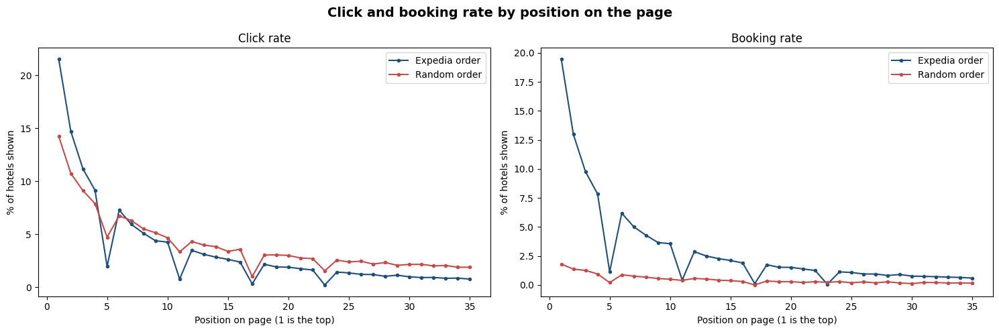
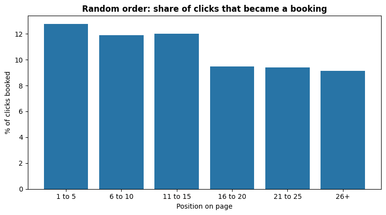

# Hotel Search Ranking

When someone searches for a hotel, which hotels should go at the top so that they actually book?

This project uses real hotel searches from Expedia to build a ranking model, and then looks at the results the way a hotelier would. I spent over a decade in hospitality before moving into data, so the question I care about isn't only "does the model score well?". It's also "is it pushing cheap rooms that people click on but don't book?"

**Status:** Part 1 is done. Part 2 is next.

## The data

[Personalize Expedia Hotel Searches (ICDM 2013)](https://www.kaggle.com/c/expedia-personalized-sort), from Kaggle. About 10 million rows from roughly 400,000 searches. For each search it shows every hotel that was displayed, its position on the page, price, star rating, review score, and whether the user clicked or booked.

About 30% of the searches were shown in **random order**. That makes this dataset unusual: it lets me measure how much of a hotel's clicks come from its position on the page rather than from the hotel itself.

## Plan

| Part | Notebook | What it answers |
|---|---|---|
| 1 | `01_data_and_position_bias.ipynb` | What does the data look like, and how much does position on the page drive clicks? |
| 2 | `02_features_and_baseline.ipynb` | Simple baselines (popularity, price, review score) and the features the model will use |
| 3 | `03_lambdarank_model.ipynb` | A LightGBM LambdaRank model, scored with NDCG@5 and NDCG@38 |
| 4 | `04_hotelier_view.ipynb` | Which features drive bookings, and whether the model ranks hotels too highly when they get clicks but not bookings |

Scoring follows the original competition: a booking counts 5 points, a click 1 point, nothing 0, measured with NDCG.

## Part 1 findings

* **Position alone triples clicks.** In searches shown in random order, hotels in the top 5 got 3.2 times the clicks of hotels at positions 11 to 25. Expedia's own ranking adds a smaller extra lift on top of that (1.3 times).
* **Top clicks aren't "cheap".** I expected clicks at the top to turn into bookings less often. It's the other way round: 13% of top 5 clicks led to a booking, against about 9% further down. Position mostly decides which hotels people look at in the first place.
* **Watch how the data was sampled.** 94% of normal searches in the data end in a booking, against 13% of random ones. That gap says more about how searches were picked for the dataset than about the value of ranking, so I don't use it as a result.
* **Price needs cleaning.** Most prices are normal nightly rates, but the maximum is over $9.6 million, and some countries show price per stay instead of per night. I compare prices within each search instead.

## How to run it

1. Download the training data from the [competition page](https://www.kaggle.com/c/expedia-personalized-sort) on Kaggle (you need a free account and have to accept the competition rules).
2. Upload it to your Google Drive. The zip or the unzipped `train.csv` both work.
3. Open the notebook in Google Colab and paste your file's ID into `DRIVE_FILE_ID`. The ID is the long code in the file's share link, between `/d/` and `/view`.
4. Run all cells. The first run copies the file into Colab and saves a 25% sample of searches back to your Drive. Later runs load that sample in seconds.

## Author

Siddharth Suman, Data Analyst, Berlin
[LinkedIn](https://www.linkedin.com/in/siddharthsuman06)
